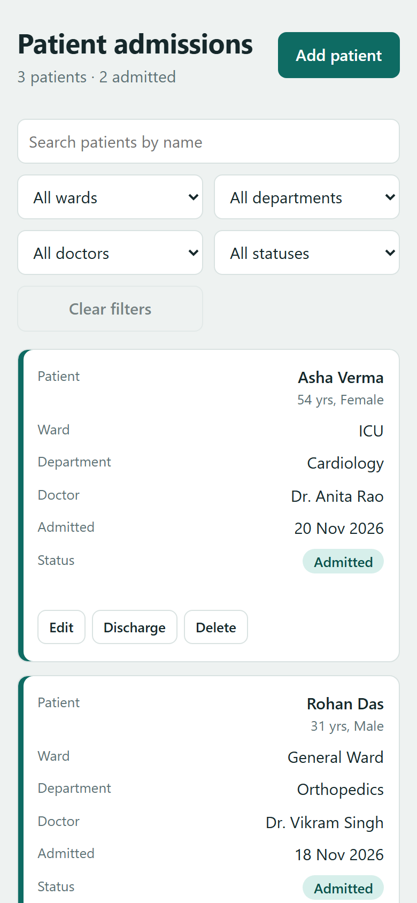

# Patient Admission Management App

A web app for hospital staff to manage admitted patients: add, view, filter, search, edit, delete and discharge.

**Live app:** https://patiens-admission-management.vercel.app/
**Live API (patients):** https://patiens-admission-management.vercel.app/api/patients
**GitHub repository:** https://github.com/Suresh97400/patiens_admission_management

## Tech stack

| Layer | Technology |
|---|---|
| Frontend | React.js (Vite), plain CSS |
| Backend | Python, FastAPI, Pydantic (validation), SQLAlchemy |
| Database | Neon PostgreSQL in production (data persists across restarts); SQLite file for local development |
| Hosting | Vercel Services (frontend + FastAPI backend on one domain) + Neon PostgreSQL |

## Features
1. Add a patient
2. View list of all patients
3. Filter by Ward, Department and Doctor (plus Status)
4. Search patients by name
5. Edit a patient
6. Delete a patient (with confirmation)
7. Mark a patient as Discharged
8. Responsive design: table on desktop/tablet, cards on mobile

## Validation (frontend AND backend)
| Field | Rule |
|---|---|
| Name | Required, letters only |
| Age | Required, whole number 0-120 |
| Gender, Ward, Department, Doctor | Required, must be one of the listed options |
| Admission date | Required, valid date, cannot be in the future |

The backend rejects invalid data with HTTP 400 and a clear message, e.g.
`{ "error": "Validation failed: Age must be a whole number between 0 and 120", "errors": { "age": "Age must be a whole number between 0 and 120" } }`

## Run locally

Requires Python 3.9+ and Node 18+. No database setup needed: SQLite is used automatically.

**Backend**
```
cd backend
python -m venv venv
venv\Scripts\activate            # Windows  (macOS/Linux: source venv/bin/activate)
pip install -r requirements.txt
uvicorn main:app --reload --port 8000
```
API docs: http://localhost:8000/docs

**Frontend** (new terminal)
```
cd frontend
npm install
npm run dev
```
Open http://localhost:5173 (the dev server proxies `/api` to the backend).

## Environment variables
No secrets are stored in this repo. Set these in the hosting dashboards (see `.env.example` files).

| Where | Variable | Purpose |
|---|---|---|
| Backend | `DATABASE_URL` | Postgres connection string. If unset, local SQLite is used |
| Backend | `FRONTEND_ORIGINS` | Deployed frontend URL(s), comma-separated, for CORS |
| Frontend | `VITE_API_URL` | Deployed backend URL |

## Deployment (Vercel Services + Neon)
1. **Database (Neon):** create a free Postgres project and copy the connection string (`DATABASE_URL`).
2. **Vercel:** import this repo with **Root Directory** set to `./` (repo root). `vercel.json` configures two services (`frontend` with Vite on `/(.*)` and `backend` with FastAPI on `/api/(.*)`).
3. Add `DATABASE_URL` in Vercel **Project Settings → Environment Variables** and deploy.

## API
| Method | Endpoint | Description |
|---|---|---|
| GET | `/api/options` | Dropdown values |
| GET | `/api/patients?search=&ward=&department=&doctor=&status=` | List, search and filter |
| POST | `/api/patients` | Add a patient |
| PUT | `/api/patients/{id}` | Edit a patient |
| PATCH | `/api/patients/{id}/discharge` | Mark as discharged |
| DELETE | `/api/patients/{id}` | Delete a patient |

## Project structure
```
backend/    main.py (routes, error handling), schemas.py (validation), database.py (DB setup)
frontend/   src/App.jsx, src/components/ (PatientList, PatientForm, Modal), src/api.js, src/validation.js
docs/screenshots/   screenshots used below
```

## Screenshots

### Desktop view


### Add patient form with validation errors


### Mobile view

